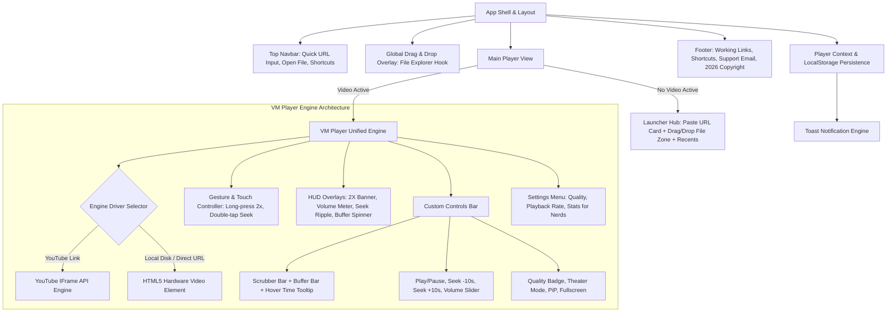

# VM Player - Architectural Specification & Technical Blueprint

## 1. Executive Overview
**VM Player** is a dedicated, precision video player web application built with React 19, TypeScript, and modern browser media APIs. It combines dual-engine playback (YouTube IFrame API integration + HTML5 Hardware Video Decoding) with advanced playback controls: sub-second 10s seeking, on-screen dynamic volume HUD, press-and-hold 2X speed boost, theater mode, keyboard ergonomics, and drag-and-drop local file ingestion.

---

## 2. System Architecture & Component Hierarchy

---

## 3. Core Engine Specifications

### 3.1 Dual-Engine Driver Architecture
- **YouTube Playback Driver**:
  - Dynamically loads `https://www.youtube.com/iframe_api`.
  - Extracts YouTube ID from any standard watch URL, `youtu.be` shortlink, embed, or shorts link.
  - Controls playback rate, volume, play/pause, and seeking programmatically under a unified gesture layer.
- **Local Media & Direct URL Driver**:
  - Uses native HTML5 `<video>` element with GPU hardware decoding.
  - Local files ingested via `URL.createObjectURL(file)` with zero server upload.
  - Supports `.mp4`, `.webm`, `.mkv`, `.mov`, `.avi`, `.m4v`.

### 3.2 Playback Mechanics
- **10-Second Seek Engine**:
  - Dedicated `-10s` and `+10s` buttons on the control toolbar.
  - Left double-click/double-tap decrements position by 10s with directional chevron ripple animation.
  - Right double-click/double-tap increments position by 10s with directional chevron ripple animation.
  - Keyboard mappings: `J` / `ArrowLeft` (-10s), `L` / `ArrowRight` (+10s).
- **Play/Pause Engine**:
  - Spacebar or `K` key shortcut, bottom control button, and center video click.
  - Transient central SVG indicator scales and fades smoothly upon state changes.
- **Dynamic Volume HUD & Animation**:
  - 4-state responsive speaker icon: Muted (0%), Low (1-33%), Mid (34-66%), and High (67-100%).
  - Real-time volume HUD overlay flashes on the screen during keyboard adjustments (`ArrowUp`, `ArrowDown`) showing numerical percentage and level bars.
- **Hold-for-2X Speed Boost**:
  - Pointer down / touch start tracking with 250ms threshold.
  - Smooth ramp to `playbackRate = 2.0` with visual banner `>> 2.0X SPEED ACTIVE [HOLDING]`.
  - Pointer release resets `playbackRate` to user's prior base rate.
