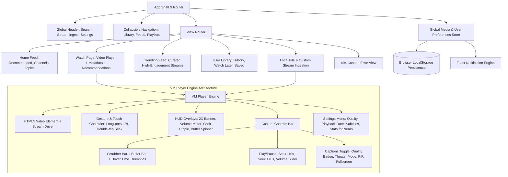

# VM Player - Architectural Specification & Technical Blueprint

## 1. Executive Overview
**VM Player** is a high-performance, studio-grade video player and video streaming web platform built with React 19, TypeScript, and modern browser media APIs. It combines advanced video playback controls (sub-second seeking, dynamic volume HUD, press-and-hold 2x speed boost, adaptive quality switching, keyboard ergonomics) with a complete media catalog experience (browse, search, categorized feeds, watch history, custom URL stream ingest, and local file playback).

---

## 2. System Architecture & Component Hierarchy

---

## 3. Core Engine Specifications

### 3.1 Playback & Seek Mechanics
- **10-Second Seek Engine**:
  - Dedicated `-10s` and `+10s` hardware-accelerated seek triggers.
  - Double-tap/double-click on left 35% of video viewport decrements position by 10s with directional chevron ripple animation.
  - Double-tap/double-click on right 35% of video viewport increments position by 10s with directional chevron ripple animation.
  - Keyboard mappings: `J` / `ArrowLeft` (-10s), `L` / `ArrowRight` (+10s).
- **Play/Pause Engine**:
  - Center-viewport click, bottom control button, and `Space` / `K` keyboard shortcuts.
  - Transient central SVG indicator that scales and fades smoothly upon state transition.
- **Dynamic Volume HUD & Animation**:
  - Real-time volume gauge with 4 distinct visual states: Muted (0%), Low (1-33%), Mid (34-66%), High (67-100%).
  - Volume HUD overlay flashes on the screen during keyboard adjustments (`ArrowUp`, `ArrowDown`) showing numerical percentage and level bars.
  - Exponential acoustic volume curve for natural auditory response.
- **Hold-for-2X Speed Boost**:
  - Pointer down / touch start tracking with 250ms threshold.
  - Smooth ramp to `playbackRate = 2.0` with visual banner `>> 2X Speed`.
  - Pointer release resets `playbackRate` to user's previously configured base rate (e.g. 1.0x).
  - Also toggled via keyboard hold (`Space` hold or `Shift + >`).
- **High-Quality Adaptive Stream Support**:
  - Multi-resolution stream ladder (1080p60, 720p, 480p, 360p, Auto).
  - Track buffered time ranges via `HTMLMediaElement.buffered` with a dedicated dual-layer track.
  - Picture-in-Picture (PiP) via `requestPictureInPicture()` with API fallback.
  - Custom stream ingestion for any valid MP4, WebM, or HLS link.
  - Zero-upload local video playback via `URL.createObjectURL(file)`.

---

## 4. UI Architecture & Anti-"Vibe-Coding" Design System

The application strictly enforces solid, high-contrast, production broadcast design:

| Element | Specification | Rationale |
| :--- | :--- | :--- |
| **Color System** | Studio Deep Slate (`#0B0E14`, `#121620`, `#1A202C`), High-Contrast Pure White (`#FFFFFF`), Studio Red (`#E50914`), Zinc Neutral (`#71717A`) | Avoids low-contrast dark mode and generic purple gradients; maximizes readability. |
| **Typography** | `Plus Jakarta Sans`, system `-apple-system`, `Segoe UI`, `Roboto` | Clean geometric humanist typography without overused Inter or serif italic gimmicks. |
| **Surfaces** | Solid opaque surfaces with crisp 1px borders (`#262E3D`, `#2D3748`) | Eliminates fragile glassmorphism and colored left borders. |
| **Transitions** | Fast, deterministic micro-interactions (`150ms ease-out`), crisp button background shifts | No fading scroll triggers, no cursor light beams, no button opacity fade bugs. |
| **Icons** | Custom, purpose-built SVG symbols optimized for video broadcast | Cohesive stroke weight (2px), pixel-aligned, no bloated generic icon sets. |
| **Layout & Grid** | Strict 4px/8px rhythm (`gap-4`, `p-4`, `p-6`), `overflow-x-hidden` on root container | 100% mobile-optimized with collapsible sidebar drawer and full touch-control support. |

---

## 5. Keyboard Navigation & Accessibility Matrix

| Key Code | Target Action | Visual Feedback |
| :--- | :--- | :--- |
| `Space` / `K` | Toggle Play / Pause | Central animated glyph + bottom bar icon |
| `J` / `ArrowLeft` | Seek backward 10 seconds | Left chevron ripple animation (-10s) |
| `L` / `ArrowRight` | Seek forward 10 seconds | Right chevron ripple animation (+10s) |
| `ArrowUp` | Increase volume by 5% | Top-right HUD volume meter & sound icon |
| `ArrowDown` | Decrease volume by 5% | Top-right HUD volume meter & sound icon |
| `M` | Toggle Mute | Mute indicator on HUD and control bar |
| `F` | Toggle Fullscreen | Viewport expansion to native fullscreen |
| `T` | Toggle Theater Mode | Widescreen player expansion above metadata |
| `C` | Toggle Closed Captions | Captions overlay toggle & active underline |
| `I` | Toggle Mini-Player / PiP | System Picture-in-Picture window |
| `>` / `<` | Speed up / Slow down step | Speed badge updated in settings menu |
| `?` | Show Shortcuts Modal | Comprehensive interactive shortcuts sheet |
