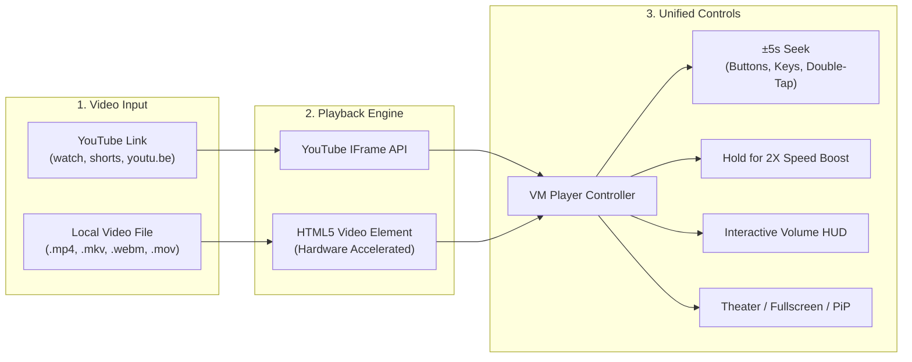
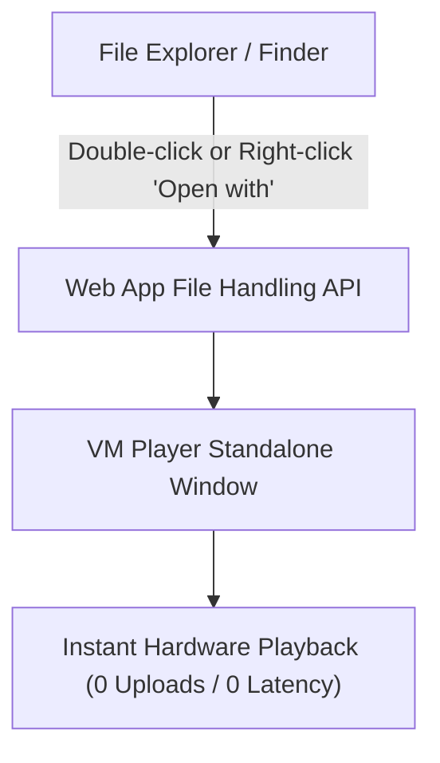

# VM Player

A high-performance standalone video player and media streaming web application built with React 19, TypeScript, and modern browser media APIs. VM Player provides dual-engine playback, combining instant YouTube streaming with native hardware-accelerated local video playback.


---

## Technical Specifications at a Glance

| Category | Specification |
| :--- | :--- |
| **Architecture** | Dual-Engine: YouTube IFrame API + Native HTML5 Video |
| **Tech Stack** | React 19, TypeScript, Vite, Tailwind CSS |
| **Input Methods** | YouTube URLs (Paste) + Local Video Files (Drag & Drop) |
| **Supported Formats** | `.mp4`, `.webm`, `.mkv`, `.mov`, `.avi`, `.m4v`, `.ogv` |
| **Seeking Step** | Precision `±5 seconds` (Toolbar buttons, Hotkeys, Screen Double-Tap) |
| **Speed Range** | `0.25x` to `2.0x` (with instant Press-and-Hold for `2.0x` boost) |
| **Desktop Installation** | Progressive Web App (PWA) with native OS File Handling API |
| **Offline Ready** | Service Worker app shell caching |

---

## Playback Pipeline Overview



---

## Core Capabilities

### 1. YouTube Video Streaming
- Paste any YouTube link (standard watch URL, `youtu.be` shortlink, embed, or Shorts).
- Automatically queries metadata and controls playback through the unified VM Player UI.
- No third-party video downloaders or external servers required.

### 2. Local Video File Playback
- Drag and drop any video file from Windows File Explorer or Mac Finder into the browser window.
- Decoded entirely on your device with GPU hardware acceleration.
- Zero upload time, zero network usage, and zero privacy exposure.

### 3. Precision ±5-Second Seeking
- Dedicated `-5s` and `+5s` buttons on the control toolbar.
- Quick keys: `J` or `ArrowLeft` for `-5s`, `L` or `ArrowRight` for `+5s`.
- On-screen touch/mouse: Double-click the left 35% of the video to jump back 5s; double-click the right 35% to jump forward 5s.

### 4. Press-and-Hold 2X Speed Boost
- Long-press or click-and-hold anywhere on the screen for over 250ms to instantly ramp playback to `2.0x`.
- Visual on-screen HUD confirms: `>> 2.0X SPEED ACTIVE [HOLDING]`.
- Releasing immediately restores your normal playback speed.

### 5. Interactive Volume HUD
- Real-time on-screen volume meter with animated level bars and numerical percentage.
- 4-state speaker icon: Muted (0%), Low (1-33%), Mid (34-66%), High (67-100%).
- Quick keyboard adjustment via `ArrowUp` and `ArrowDown` keys.

---

## Desktop Installation & File Associations (PWA)

VM Player can be installed directly onto your operating system like a native desktop media player.



### Installation Steps
1. Open VM Player in **Google Chrome**, **Microsoft Edge**, or **Brave**.
2. Click the **Install App** button in the top navbar (or click the install icon in your browser's address bar).
3. Confirm **Install**. VM Player will now appear in your Start Menu, Taskbar, and Applications list.

### Opening Files Directly in VM Player
- Right-click any video file (`.mp4`, `.mkv`, `.webm`, etc.) in File Explorer.
- Select **Open with** &rarr; **VM Player**.
- Check *"Always use this app to open files"* to make VM Player your default system media player.

---

## Keyboard Shortcuts Reference

| Command | Keyboard Key | Mouse / Touch Gesture |
| :--- | :--- | :--- |
| **Play / Pause** | `Space` or `K` | Click center of video screen |
| **Seek Backward (-5s)** | `J` or `ArrowLeft` | Double-click left side of video |
| **Seek Forward (+5s)** | `L` or `ArrowRight` | Double-click right side of video |
| **2X Speed Boost** | - | Click & hold on video screen |
| **Volume Up (+5%)** | `ArrowUp` | Scroll wheel up over video |
| **Volume Down (-5%)** | `ArrowDown` | Scroll wheel down over video |
| **Mute / Unmute** | `M` | Click volume speaker icon |
| **Toggle Fullscreen** | `F` | Click fullscreen button |
| **Toggle Theater Mode** | `T` | Click theater button |
| **Picture-in-Picture** | `I` | Click PiP button |
| **Shortcuts Cheat Sheet** | `?` | Click keyboard icon in navbar |

---

## Security & Protection Checklist

| Security Risk | Mitigation Strategy | Implementation Details |
| :--- | :--- | :--- |
| **Protocol Injection** | Strict Protocol Whitelisting | Allows only `http:` and `https:`; rejects `javascript:`, `data:`, and `file:` schemes |
| **Memory Leak (DoS)** | Automatic Blob URL Revocation | Calls `URL.revokeObjectURL()` on file changes, resets, and unmounts |
| **Script Injection (XSS)** | Content Security Policy (CSP) | Strict `meta` CSP restricts script and frame origins to local and YouTube APIs |
| **DOM Injection** | Input Sanitization | Strips control characters, angle brackets `<>`, and caps string lengths |
| **MIME Sniffing** | Security Header Configuration | `X-Content-Type-Options: nosniff` and `strict-origin-when-cross-origin` |
| **Package Vulnerabilities** | Automated Audit | 0 vulnerabilities confirmed across dependencies via `npm audit` |

---

## Project Structure

```text
VM-Player/
├── public/
│   ├── favicon.svg             # Application brand icon
│   ├── icon-192.png            # PWA standard application icon
│   ├── icon-512.png            # PWA splash application icon
│   ├── manifest.webmanifest    # Web App Manifest & OS file associations
│   └── sw.js                   # Service Worker for offline app caching
├── src/
│   ├── components/
│   │   ├── common/             # Navbar, Footer, Toast, Icons
│   │   ├── player/             # VMPlayer, Controls, Timeline, HUDs
│   │   ├── stream/             # Keyboard shortcuts sheet
│   │   └── views/              # Main player view & drag-and-drop zone
│   ├── context/                # PlayerContext (state, cleanup) & ToastContext
│   ├── types/                  # TypeScript media & PWA declarations
│   ├── utils/                  # YouTube ID extraction utility
│   ├── index.css               # Tailwind CSS & keyframe animations
│   ├── main.tsx                # React entrypoint & Service Worker registration
│   └── App.tsx                 # Root layout & OS launchQueue handler
├── index.html                  # HTML entrypoint with CSP & security headers
├── package.json
└── README.md                   # Project documentation
```

---

## Getting Started

### 1. Clone & Install
```bash
git clone https://github.com/Vedant-npc/VM-Player.git
cd VM-Player
npm install
```

### 2. Run Development Server
```bash
npm run dev
```

### 3. Production Build
```bash
npm run build
npm run preview
```

---

## License & Attribution

VM Player is open-source under the MIT license.  
© 2026 VM Player. All rights reserved.
