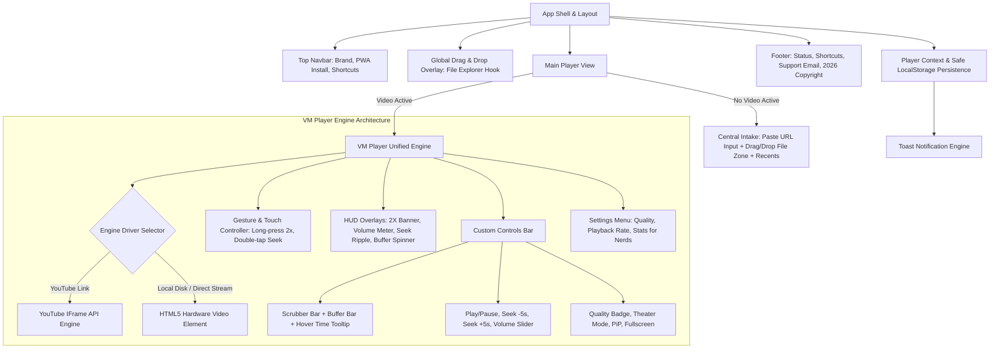

# VM Player

A studio-grade standalone video player and media streaming web application built with React 19, TypeScript, and modern browser media APIs. VM Player provides dual-engine playback, combining instant YouTube streaming via link paste with native hardware-accelerated local video drag-and-drop playback.


---

## 1. System Architecture & Component Hierarchy



---

## 2. Core Capabilities

1. **Paste & Play YouTube Videos**:
   - Paste any YouTube watch link, short link (`youtu.be/...`), embed, or YouTube Shorts URL directly into the player.
   - Automatically extracts and controls the stream via the YouTube Engine, giving you seamless control with all of VM Player's custom controls.

2. **Drag & Drop Local Video Files**:
   - Simply drag and drop any local video file (`.mp4`, `.webm`, `.mkv`, `.mov`, `.avi`, `.m4v`) from your File Explorer anywhere onto the browser window.
   - Decoded client-side with hardware acceleration via native browser blob pipelines with zero upload latency and zero server transfer.

3. **Sub-Second 5-Second Seeking**:
   - Control bar `-5s` and `+5s` buttons.
   - Double-click or double-tap on the left 35% of the video viewport for `-5s` with animated chevron ripples; right 35% for `+5s`.
   - Keyboard shortcuts: `J` or `ArrowLeft` (-5s), `L` or `ArrowRight` (+5s).

4. **Hold for 2X Speed Boost**:
   - Long-press / touch-hold anywhere on the video viewport for >250ms to instantly ramp playback to `2.0x`.
   - Displays an authoritative top-center banner: `>> 2.0X SPEED ACTIVE [HOLDING]`.
   - Releasing immediately restores your prior base playback rate (e.g. 1.0x).

5. **Dynamic Volume HUD & Animation**:
   - 4-state responsive speaker icon: Muted (0%), Low (1-33%), Mid (34-66%), High (67-100%).
   - Precision acoustic volume slider.
   - Adjusting volume via `ArrowUp` or `ArrowDown` flashes an on-screen HUD meter with animated level bars and numerical percentage.

6. **Play & Pause Mechanics**:
   - Spacebar or `K` key shortcut, bottom play/pause button, or center video click.
   - Central transient animated SVG indicator scales and fades smoothly upon state changes.

7. **Theater Mode, Fullscreen & Telemetry**:
   - Theater Mode (`T` key) expands the player to widescreen.
   - Fullscreen (`F` key) expands to full viewport.
   - Stats for Nerds overlay tracking resolution, viewport dimensions, buffer health, dropped frames, and decoder pipeline.

8. **Device Installation & Desktop File Handling (PWA)**:
   - Installable as a standalone desktop or mobile application directly onto your operating system via Chrome, Edge, Safari, or Brave.
   - Integrates the Web App File Handling API (`file_handlers` for `.mp4`, `.webm`, `.mkv`, `.mov`, `.avi`, `.m4v`), allowing your OS to open local movie files directly with VM Player.
   - Offline service worker caching (`sw.js`) so your player launches instantly even without an internet connection.

---

## 3. Dual-Engine Driver Architecture

### 3.1 YouTube Playback Driver
- Dynamically loads `https://www.youtube.com/iframe_api`.
- Extracts YouTube ID from any standard watch URL, `youtu.be` shortlink, embed, or shorts link.
- Controls playback rate, volume, play/pause, and seeking programmatically under a unified gesture layer.

### 3.2 Local Media & Direct URL Driver
- Uses native HTML5 `<video>` element with GPU hardware decoding.
- Local files ingested via `URL.createObjectURL(file)` with zero server upload.
- Active memory cleanup via `URL.revokeObjectURL()` on file changes and unmounts.
- Supports `.mp4`, `.webm`, `.mkv`, `.mov`, `.avi`, `.m4v`, `.ogv`.

---

## 4. Security & Hardening Architecture

VM Player includes defense-in-depth security hardening against client-side and web-based attack vectors:

- **Strict Protocol Validation**: Video intake filters and strictly whitelists network protocols to `http:` and `https:`, blocking `javascript:`, `data:`, `file:`, or pseudo-protocol code injection attacks.
- **Content Security Policy (CSP)**: Built-in `meta` CSP enforcing `default-src 'self'`, `object-src 'none'`, and constraining script, frame, media, and connect origins exclusively to local assets and official YouTube/Google endpoints.
- **Memory Leak & DoS Prevention**: Local video playback uses an active blob URL registry that automatically revokes (`URL.revokeObjectURL`) memory allocations on every file switch, clear, and page unload, preventing memory exhaustion when opening massive 1080p/4K movie files.
- **Input Sanitization**: Titles, filenames, and query parameters are stripped of control characters, angle brackets, and non-printable bytes to prevent DOM clobbering and XSS.
- **Referrer Policy & MIME Sniffing Protection**: Enforces `strict-origin-when-cross-origin` and `X-Content-Type-Options: nosniff`.
- **Zero Package Vulnerabilities**: Audited clean with zero security advisories.

---

## 5. Keyboard Shortcuts Reference

| Shortcut | Action |
| :--- | :--- |
| `Space` or `K` | Toggle Play / Pause |
| `J` or `ArrowLeft` | Seek backward 5 seconds |
| `L` or `ArrowRight` | Seek forward 5 seconds |
| `Hold Pointer on Screen` | Hold for 2.0X Speed Boost |
| `ArrowUp` | Volume Up (+5%) |
| `ArrowDown` | Volume Down (-5%) |
| `M` | Toggle Mute |
| `F` | Toggle Fullscreen |
| `T` | Toggle Theater Mode |
| `I` | Toggle Picture-in-Picture |
| `?` | Open Keyboard Shortcuts Sheet |

---

## 6. Getting Started

### Installation
```bash
git clone https://github.com/Vedant-npc/VM-Player.git
cd VM-Player
npm install
```

### Running Locally
```bash
npm run dev
```

### Production Build
```bash
npm run build
npm run preview
```

---

## 7. License & Attribution

VM Player is open-source under the MIT license.  
© 2026 VM Player. All rights reserved.
